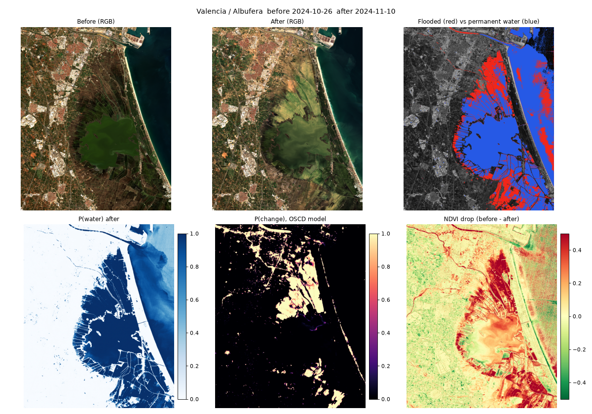
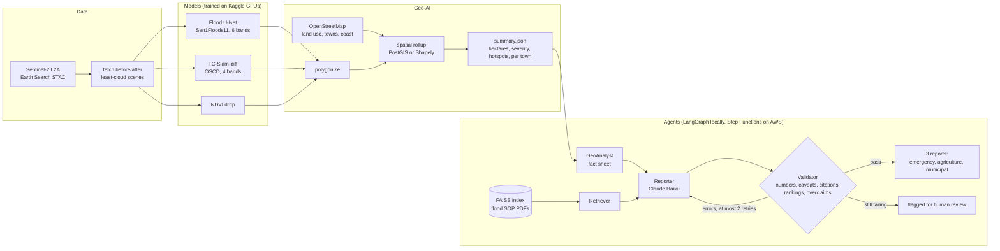
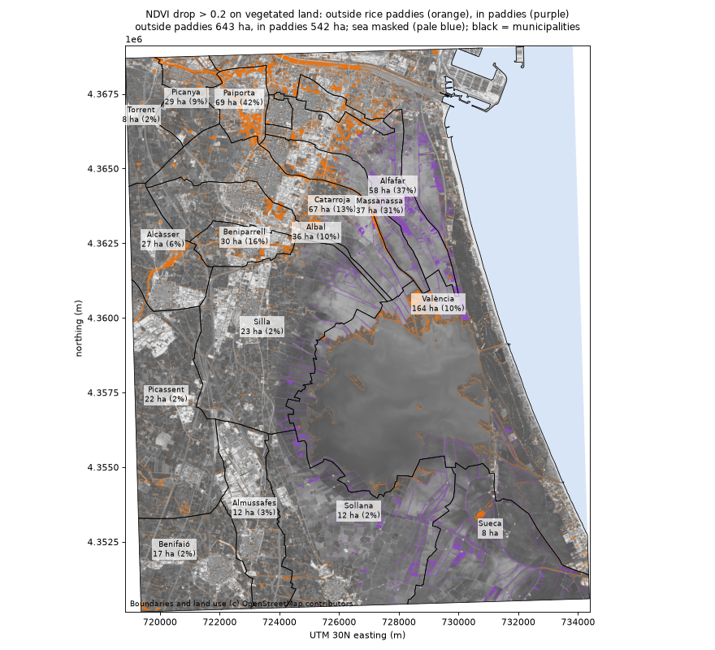
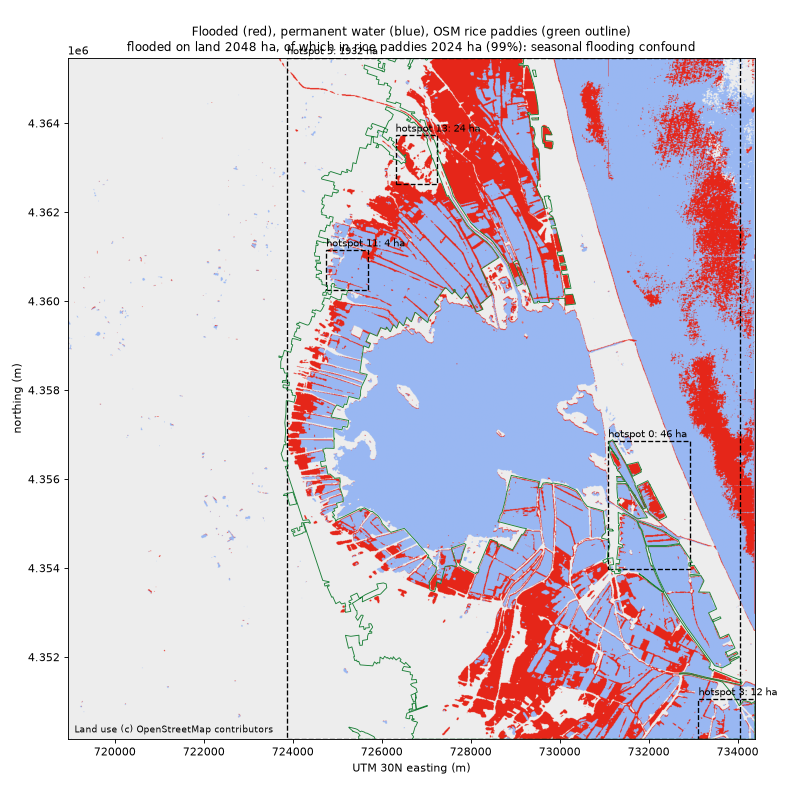
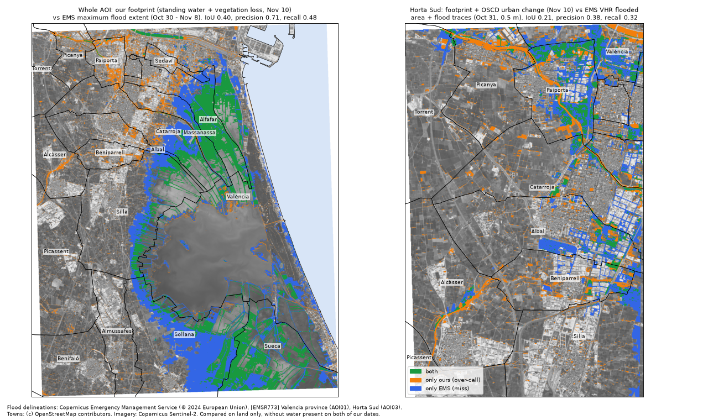
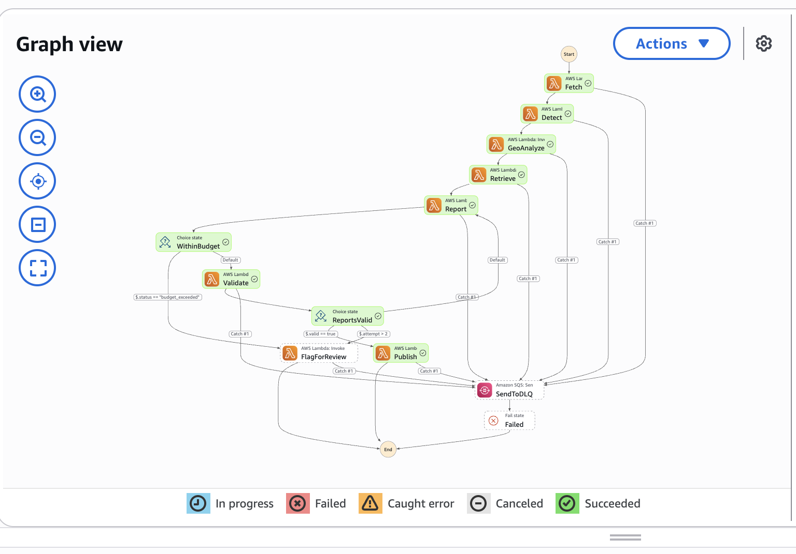
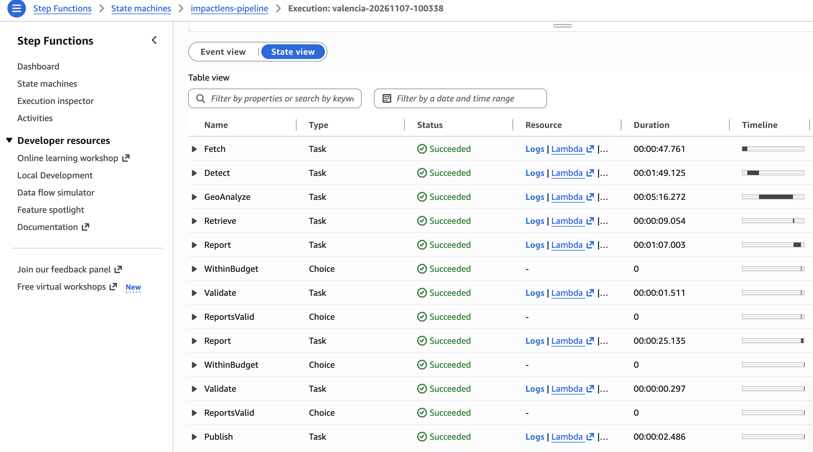

# ImpactLens

[](https://github.com/bhavishyabondalapati/impactlens/actions/workflows/ci.yml)

**Satellite images in, validated disaster-impact reports out.** An independent project built
entirely on public data.
ImpactLens takes before/after Sentinel-2 images of an area, maps flood water and land change
with two U-Nets I trained, turns the pixels into hectares per field and per town, and has six
LLM agents write reports in which every number is checked by code. Each report is written for a
different reader. The flood U-Net reaches **test F1 0.92** on Sen1Floods11, against 0.87 for the
best tuned water-index baseline. The OSCD change model reaches test F1 0.49. On the October 2024
Valencia floods, with no location hints, the pipeline ranks **Paiporta, Sedaví and Alfafar**
highest for vegetation loss (37-42% of their vegetated land, against 2-3% in similar farm towns
nearby). Those are the towns along the Barranco del Poyo, where the flood hit hardest. Checked
against the official **Copernicus EMS EMSR773** maps, that town ranking agrees with the 0.5 m
delineation (**Spearman 0.85**, Paiporta first on both). Pixel-level agreement is moderate: 71%
of the footprint lies inside the official flood extent, and the footprint covers 48% of it. The
whole pipeline runs serverless on AWS (S3, SQS, Lambda, Step Functions, Terraform) for about
**$0.07 per run** and under $0.20 a month when idle.



## Results

| what | result | details |
|---|---|---|
| Flood water U-Net (6 Sentinel-2 bands), Sen1Floods11 test | **F1 0.92**, IoU 0.85 | best tuned water index (NDWI / MNDWI): F1 0.87 |
| ...same model, Bolivia (a country never seen in training) | F1 0.90 | |
| Change detection FC-Siam-diff, OSCD test (10 cities) | **F1 0.49**, IoU 0.32 | OSCD labels are urban change only |
| Valencia: vegetation loss outside rice paddies | 643 ha | Paiporta 42%, Sedaví 41%, Alfafar 37% of vegetated land, against 2-3% in Silla, Sollana, Benifaió |
| Valencia: new standing water on land (Nov 10) | 2,104 ha | 98% in rice paddies, flagged as a confound |
| vs Copernicus EMS, town ranking (0.5 m delineation) | **Spearman 0.85** (12 towns) | [docs/VALIDATION.md](docs/VALIDATION.md) |
| vs Copernicus EMS, maximum flood extent | IoU 0.40, precision 0.71, recall 0.48 | 2.8x better than chance |
| vs Copernicus EMS, water 2 days before our image | 89% of their flood found | |
| Reports: deterministic validator | 3 / 3 reports pass on AWS (2 needed one retry) | 5 Haiku calls, $0.053, hard cap $0.10 |
| AWS run, request to reports | about 9.5 min | Step Functions screenshots below |

Model selection and early stopping used validation data only (OSCD: 3 held-out training
cities; Sen1Floods11: its `valid` split). Test and Bolivia numbers were computed once at the end.

## How it works



1. **Imagery.** For an area of interest (AOI) and two date windows, the fetcher searches the
   Earth Search STAC catalogue, picks the least cloudy scene in each window and writes aligned
   10 m crops.
2. **Change detection.** A 6-band U-Net maps water on each date, so *flooded* means water after
   and not before. A Siamese U-Net (FC-Siam-diff) maps general change. NDVI drop maps vegetation
   loss. Inference runs in 256 px tiles blended with a Hann window, through ONNX.
3. **Geo-AI rollup.** Masks become polygons, which are joined with OpenStreetMap land use, towns
   and coastline. The result is hectares per plot, land-use class and town, a severity score per
   plot, and DBSCAN hotspots. It runs on PostGIS locally and on a Shapely reimplementation in
   Lambda, and a test checks that both give the same numbers.
4. **Agents.** Six agents: Ingest, Detect, GeoAnalyst, Retriever, Reporter and Validator. The
   GeoAnalyst turns the summary into a fact sheet. The Retriever pulls flood-response SOP excerpts
   from a FAISS index. The Reporter (Claude Haiku 4.5) writes three reports.
5. **Validation loop.** The Validator is plain code, not an LLM. It checks:
   - every number against the fact sheet, within rounding;
   - the required caveats;
   - a citation on every method sentence;
   - that ranked lists follow the data;
   - that no claim like "confirmed mud" rests on an NDVI proxy.

   Errors go back to the Reporter, at most twice. A report that still fails is flagged for human
   review instead of being published.
6. **Deployment.** Uploading a request JSON to S3 starts a Step Functions run through SQS and a
   starter Lambda. One arm64 container image without PyTorch serves seven Lambdas; failures go to
   a dead-letter queue. All of it is Terraform.

### The Valencia DANA floods, 29 Oct 2024

Before image Oct 26, after image Nov 10 (Sentinel-2). By day 12 the water in the towns had
drained, so the damage shows up as vegetation loss and mud rather than standing water:



New water was mostly in the Albufera rice paddies. The paddies are flooded on purpose in late
autumn, so they are flagged as a confound instead of being counted as damage:



Our footprint compared with the official Copernicus EMS flood maps. Green is where both agree,
orange is ours only, blue is EMS only:



### On AWS

One run of the state machine. The Report -> Validate loop ran twice, because the first drafts of
two reports failed the validator:





| cost | amount |
|---|---|
| per run, measured (Nov 7, 2026) | about **$0.07**: Claude Haiku $0.053 (5 calls) + Lambda about 1,400 GB-s ($0.02, inside the free tier) + Step Functions $0.0004 |
| idle | about **$0.05-0.20 a month**, mostly ECR image storage. No NAT gateway, VPC, database or always-on compute |

## Known limits

- **Rice-paddy confound.** The Albufera paddies are flooded on purpose in late autumn, and the
  floodwater also drained into them. Two optical dates cannot separate the two causes. 98% of the
  new water is in paddies, so the paddies are reported on their own line and never counted as
  damage.
- **NDVI drop is a proxy.** It is consistent with mud and flattened crops, but harvest, ploughing
  and pruning also drop NDVI. Mud on streets and roofs is invisible to it, because that ground was
  never vegetated. Against the 0.5 m EMS map we find 32% of the mapped flood traces in Horta Sud.
  The validator rejects reports that call a proxy "confirmed".
- **L1C / L2A gap.** OSCD and Sen1Floods11 are Level-1C (top of atmosphere); live imagery is
  Level-2A (surface reflectance). On land the water mask still agrees with MNDWI (IoU 0.94), but
  the model under-calls dark open sea. The sea is masked out with the OSM coastline and enters no
  total.
- **Date gap.** The first clear Sentinel-2 image after the flood is Nov 10, twelve days later.
  EMS mapped the peak on Oct 30-31, so most of the water we compare against had drained.
- **AOI.** One rectangle around l'Horta Sud and the Albufera (about 278 km²). Picanya and Torrent
  are only partly inside it, and other affected towns (Aldaia, Alaquàs, Xirivella) are outside.
  The report prompts also name Valencia's stakeholders.
- **OSCD labels are urban only.** The change model was trained on urban construction. It fires on
  any big visual change, including paddies, ships in the port and fields, so its output is only
  counted on residential and industrial land. That is also why a separate flood model exists.
- **Test numbers are from one held-out split each.** No cross-validation, and OSCD has only 24
  cities.

## Tools and why

| tool | why |
|---|---|
| **PyTorch** (Apple `mps` locally, CUDA on Kaggle) | training both U-Nets; free Kaggle GPUs for the heavy runs |
| **ONNX + onnxruntime** | one exported model file runs on the Mac, in tests and in Lambda, without PyTorch (700 MB) |
| **rasterio, NumPy, SciPy** | reading and writing GeoTIFFs, raster maths, rank statistics |
| **pystac-client + Earth Search** | free STAC search over Sentinel-2 L2A on AWS Open Data |
| **Shapely / GEOS, PostGIS** | spatial joins and areas; PostGIS for SQL locally, Shapely (same GEOS engine) in Lambda so no database runs while idle |
| **OpenStreetMap (Overpass)** | land use, municipalities and coastline, cached per AOI |
| **LangGraph** | the six-agent graph with a bounded retry loop, run locally |
| **Anthropic Claude Haiku 4.5** | cheap, fast report writing; prompt caching plus a hard $0.10 cap per run |
| **sentence-transformers MiniLM + FAISS** | small local embeddings and vector search for the SOP corpus (exported to ONNX for Lambda) |
| **AWS: S3, SQS, Lambda (container), Step Functions, SSM, ECR** | event-driven, pay-per-run, no servers; the key lives in SSM, never in code or Terraform state |
| **Terraform + Makefile** | the whole stack as code: `make deploy` / `make destroy` |
| **uv, ruff, pytest, GitHub Actions** | reproducible installs from a lockfile, lint and format, about 160 tests in CI (with a PostGIS service container) |

## Run it

### Setup

This repo uses [uv](https://docs.astral.sh/uv/), not conda: it creates `.venv/` with Python 3.11
from `uv.lock`.

```bash
git clone https://github.com/bhavishyabondalapati/impactlens.git && cd impactlens
uv sync                       # Python 3.11 + all dependencies
cp .env.example .env          # then set ANTHROPIC_API_KEY and POSTGRES_PASSWORD in .env
scripts/set_anthropic_key.sh .env   # optional: sets the key at a hidden prompt
docker compose up -d          # local PostGIS (only for the PostGIS rollup and its tests)
```

### Locally: the Valencia pipeline

```bash
uv run impactlens fetch --aoi aoi/valencia_albufera.geojson \
    --before 2024-10-01/2024-10-28 --after 2024-10-30/2024-11-12
uv run impactlens infer --quicklook docs/images/valencia_quicklook.png      # needs the ONNX models
uv run impactlens rollup --map docs/images/valencia_rollup.png --ndvi-map docs/images/valencia_ndvi_drop.png
uv run impactlens sops                                                      # SOP corpus -> FAISS
uv run impactlens report                                                    # 3 validated reports
uv run impactlens validate-ems --map docs/images/valencia_emsr773.png       # needs data/raw/emsr773
```

The trained models are not in the repo (`build/` is gitignored). Train them on Kaggle as below,
or pass your own with `--floods-model` / `--oscd-model`. The EMS download steps are in
[docs/VALIDATION.md](docs/VALIDATION.md).

### Tests and lint

```bash
uv run pytest                 # all tests; PostGIS and local-data tests skip if missing
uv run ruff check . && uv run ruff format --check .
```

CI runs `uv run pytest -m "not needs_data and not network"` with a PostGIS service container,
plus `terraform fmt -check` and `terraform validate`.

### Training on Kaggle

```bash
uv run python scripts/pack_for_kaggle.py    # pack OSCD + Sen1Floods11 (needs data/raw/)
make kaggle-run                             # push, upload data if changed, run on a GPU, fetch results
```

`make kaggle-run` asks before every push, upload and GPU run. Step by step:
[docs/KAGGLE.md](docs/KAGGLE.md).

### On AWS

```bash
make local                    # the whole state machine inside the Lambda image, no AWS, fake LLM
aws login --profile sky       # then, against your own account:
make deploy                   # ECR, image, Terraform stack, models + index to S3
make set-key                  # Anthropic key -> SSM (hidden prompt)
make demo                     # upload the Valencia request, wait, download the reports
make destroy                  # delete everything
```

Region us-east-2. Details, security and cost: [docs/AWS.md](docs/AWS.md).

## File structure

| path | what it is |
|---|---|
| `README.md` | this page |
| `LICENSE` | MIT license for the code |
| `pyproject.toml` | package metadata, dependencies, CPU-only torch on Linux, pytest markers, ruff config |
| `uv.lock` | exact versions of every dependency |
| `requirements.txt` | pip-style export of the lockfile (`uv export`) |
| `.env.example` | placeholder keys; copy to `.env` (gitignored) |
| `.gitignore` / `.dockerignore` | keeps data, models, builds and secrets out of git and the image |
| `docker-compose.yml` | local PostGIS for the rollup |
| `Makefile` | test, lint, Kaggle and AWS commands |
| `.github/workflows/ci.yml` | GitHub Actions: ruff + pytest (with PostGIS), Terraform fmt/validate |
| `aoi/valencia_albufera.geojson` | the Valencia area of interest |
| **src/impactlens/** | |
| `cli.py` | `impactlens` command: fetch, infer, rollup, validate-ems, sops, report, export-embedder, aws-local |
| `data/stac.py` | Earth Search STAC search, least-cloud scene choice, aligned before/after crops |
| `data/preprocess.py` | band order, reflectance scaling and clipping, tiling |
| `data/oscd.py` | OSCD change-detection loader, with the 3 held-out validation cities |
| `data/sen1floods11.py` | Sen1Floods11 flood-water loader (train / valid / test / Bolivia) |
| `data/packed.py` | compact `.npz` copies of both datasets for Kaggle |
| `models/blocks.py` | conv blocks shared by both networks |
| `models/unet.py` | the flood-water U-Net |
| `models/siamese_unet.py` | FC-Siam-diff change detector |
| `models/losses.py` | BCE + soft Dice, ignoring invalid pixels |
| `models/metrics.py` | IoU, F1, precision, recall over valid pixels |
| `models/baseline.py` | NDWI / MNDWI water-index baselines, fixed and tuned thresholds |
| `models/train.py` | training loop, early stopping on validation F1, threshold tuning, test, export |
| `models/export.py` | ONNX export with a PyTorch-vs-ONNX check |
| `geo/inference.py` | sliding-window inference with Hann blending through ONNX |
| `geo/indices.py` | NDVI, NDWI, MNDWI on reflectance |
| `geo/layers.py` | flooded / changed / NDVI-drop layers, water-index agreement, maps |
| `geo/polygonize.py` | masks to polygons with mean confidence |
| `geo/osm.py` | Overpass queries, land-use classes, towns, land side of the coastline |
| `geo/postgis.py` | PostGIS backend: load, run the SQL rollup, export GeoJSON |
| `geo/sql/schema.sql`, `geo/sql/rollup.sql` | tables and the spatial SQL (land cover, impacts, severity, DBSCAN hotspots, towns) |
| `geo/rollup_shapely.py` | the same rollup in Shapely, for Lambda |
| `geo/summary.py` | turns either backend's tables into `summary.json` |
| `geo/pipeline.py` | the `infer` and `rollup` steps end to end |
| `geo/validation.py` | comparison with Copernicus EMS EMSR773: overlap metrics, per town, map |
| `agents/facts.py` | the fact sheet the Reporter writes from |
| `agents/sources.py` | the SOP corpus list, with each document's licence |
| `agents/rag.py` | download, chunk, embed and FAISS-index the SOPs; retrieval |
| `agents/embed_onnx.py` | MiniLM exported to ONNX for Lambda |
| `agents/llm.py` | Anthropic client with token logging and the hard cost cap |
| `agents/reporter.py` | the Reporter prompts for the three audiences |
| `agents/validator.py` | deterministic checks: numbers, caveats, citations, rankings, overclaims |
| `agents/steps.py` | agent steps shared by LangGraph and Step Functions |
| `agents/graph.py` | the six-agent LangGraph graph |
| `aws/handlers.py` | Lambda entry points, SSM key loading, the SQS starter |
| `aws/steps.py` | each pipeline step against S3 (fetch, detect, geo, retrieve, report, validate, finish) |
| `aws/store.py` | S3 and local-folder storage with one interface |
| `aws/local.py` | runs the real Step Functions definition locally |
| **infra/** | |
| `main.tf`, `variables.tf`, `outputs.tf` | provider (us-east-2 only), settings with validation, outputs |
| `s3.tf`, `sqs.tf`, `ssm.tf`, `ecr.tf` | private bucket, queue + DLQ, key parameter (placeholder), image repository |
| `lambda.tf`, `iam.tf`, `stepfunctions.tf` | seven Lambdas, one least-privilege role each, the state machine |
| `statemachine/pipeline.asl.json.tftpl` | the Step Functions definition (Amazon States Language) |
| `docker/Dockerfile`, `docker/requirements.txt` | the arm64 Lambda image without PyTorch |
| `.terraform.lock.hcl` | pinned provider versions |
| **scripts/** | |
| `pack_for_kaggle.py`, `kaggle_run.sh`, `kaggle_log.py`, `metrics_summary.py` | Kaggle: pack data, run a round, read logs, print metrics |
| `dataset_report.py`, `clip_report.py` | sanity statistics of the real datasets and of reflectance clipping |
| `aws_push_image.sh`, `aws_upload_assets.sh`, `aws_set_key.sh`, `aws_demo.sh`, `aws_local.sh` | AWS deploy steps behind the Makefile |
| `make_request.py` | writes the Valencia request JSON |
| `set_anthropic_key.sh` | sets `ANTHROPIC_API_KEY` in a `.env` at a hidden prompt (never on screen, in history or in `ps`) |
| **notebooks/** | |
| `train_kaggle.ipynb`, `kernel-metadata.json` | the Kaggle training notebook and its kernel settings |
| **tests/** | |
| `conftest.py` | test markers and the CI network guard |
| `test_oscd.py`, `test_sen1floods11.py`, `test_preprocess.py`, `test_packed.py`, `test_stac.py` | data loaders and fetcher, on synthetic files |
| `test_models.py` | networks, losses, metrics, training, ONNX export |
| `test_geo.py` | inference, layers, OSM, and every rollup case on both PostGIS and Shapely |
| `test_validation.py` | EMS comparison metrics and parsing |
| `test_agents.py` | fact sheet, retrieval, reporter prompt, every validator check, the graph with a fake LLM |
| `test_aws.py` | the state machine run locally, the starter, Shapely vs PostGIS, OSM cache, ONNX embedder |
| `test_kaggle_setup.py`, `test_notebook.py`, `test_smoke.py` | Kaggle config, notebook structure, package imports |
| **docs/** | |
| `GEO.md` | the rollup and the Valencia results in detail |
| `VALIDATION.md` | the Copernicus EMS EMSR773 comparison |
| `REPORT_AGENTS.md` | the six report agents, validator, cost control, SOP corpus |
| `AWS.md` | architecture, deployment, cost, security |
| `KAGGLE.md` | training on Kaggle step by step |
| `clip_report.txt` | output of `scripts/clip_report.py` |
| `images/` | maps, dataset samples and Step Functions screenshots used in these docs |

## How it was built

Seven phases, each reviewed before the next started:

1. **Scaffold.** `src/` layout, uv, ruff, pytest.
2. **Data.** Loaders for OSCD and Sen1Floods11 with validation splits fixed up front, and a STAC
   fetcher that picks the clearest before/after pair for any AOI.
3. **Models.** FC-Siam-diff on OSCD, then a flood U-Net on Sen1Floods11. Round 2 added the two
   SWIR bands (6 bands in all). Training ran on Kaggle GPUs, then
   ONNX export, sliding-window inference and the NDVI layer.
4. **Geo-AI.** Polygonize, OSM land use, towns and coastline, and the spatial SQL in PostGIS.
   Then the Valencia analysis, which found the paddy confound and the vegetation-loss signal.
5. **Agents and RAG.** A FAISS index over flood-response SOPs, the six-agent LangGraph graph, and
   the deterministic Validator with a bounded retry loop. Validator false positives were fixed
   along the way, and ranking and overclaim checks were added.
6. **AWS.** The rollup was rebuilt in Shapely (parity-tested against PostGIS), MiniLM exported to
   ONNX, one Lambda image built without PyTorch, and the Terraform stack and Step Functions flow
   written. Then deployed and run on AWS.
7. **Evaluation.** The comparison with Copernicus EMS EMSR773, CI, and this README.

## Key concepts

- **Validation vs test splits.** Thresholds, checkpoints and early stopping use validation data.
  The test set is touched once, so its number is an honest estimate.
- **Why a baseline matters.** NDWI and MNDWI are free one-line water detectors. The U-Net is only
  worth having because it beats them (F1 0.92 vs 0.87).
- **Siamese networks for change.** Both dates go through the same encoder with shared weights.
  The difference of their features shows what changed, not what is there.
- **IoU, F1, precision, recall, lift.** What over-calling and missing mean on a map, and why lift
  over chance matters when one class covers a quarter of the area.
- **Confounds.** Rice paddies flooded on purpose look exactly like flood water. Being honest means
  reporting them separately instead of letting them inflate or erase the result.
- **Proxies.** NDVI drop is evidence consistent with mud, not proof. The validator enforces that
  wording.
- **Domain gap.** Training on L1C and running on L2A, checked against water indices rather than
  assumed fine.
- **Grounded LLM output.** The LLM writes; code checks every number, citation and ranking, with a
  bounded retry and a human-review fallback. That is the difference between a demo and something
  you could hand to an emergency manager.
- **Serverless trade-offs.** No database while idle (Shapely instead of PostGIS), no PyTorch in
  Lambda (ONNX), run state in S3 because each Lambda is a fresh process, and a cost cap that holds
  per run across Lambdas.
- **Infrastructure as code.** The whole stack is reviewable, reproducible and removable with one
  command.

## Data, licences and citations

| data | licence / terms | citation |
|---|---|---|
| Sentinel-2 L2A imagery (via Earth Search, AWS Open Data) | Copernicus free and open data policy | Contains modified Copernicus Sentinel data (2024) |
| Sen1Floods11 | no licence stated in the [official repository](https://github.com/cloudtostreet/Sen1Floods11); used for research only, not redistributed | Bonafilia, D., Tellman, B., Anderson, T., Issenberg, E. (2020). Sen1Floods11: a georeferenced dataset to train and test deep learning flood algorithms for Sentinel-1. CVPR Workshops, 210-211 |
| OSCD | change labels CC BY-NC-SA ([IEEE DataPort](https://ieee-dataport.org/open-access/oscd-onera-satellite-change-detection), [authors' site](https://rcdaudt.github.io/oscd)); images are modified Copernicus data. The change model trained on it is for non-commercial use | Daudt, R. C., Le Saux, B., Boulch, A., Gousseau, Y. (2018). Urban change detection for multispectral earth observation using convolutional neural networks. IGARSS 2018 |
| Copernicus EMS EMSR773 | free reproduction and adaptation with attribution ([terms](https://mapping.emergency.copernicus.eu/terms-and-conditions/)) | Copernicus Emergency Management Service (© 2024 European Union), [EMSR773] Valencia province (AOI01) and Horta Sud (AOI03): Delineation Maps |
| OpenStreetMap | ODbL | © OpenStreetMap contributors |
| Flood-response SOP documents | as stated in each document; used locally for retrieval and not redistributed | listed with URLs in [docs/REPORT_AGENTS.md](docs/REPORT_AGENTS.md) |

No dataset, model file, API key or `.env` is committed: `data/` and `build/` are gitignored.

## License

The **code** in this repository is released under the [MIT License](LICENSE). Copyright (c) 2026
Bhavishya Bondalapati.

MIT covers the code only. It does not cover:

- **Datasets and imagery** (Sentinel-2, Sen1Floods11, OSCD, Copernicus EMS, OpenStreetMap, the SOP
  documents). None are stored here, and each keeps the terms in the table above.
- **Trained models.** No model file is in this repository. A change model trained on OSCD inherits
  the non-commercial terms of its CC BY-NC-SA labels.
- **The maps in `docs/images/`.** They are derived from Copernicus Sentinel data, Copernicus EMS
  products and OpenStreetMap, and must keep those attributions.
