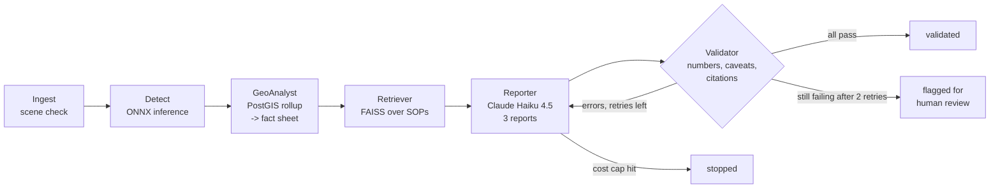

# Agents + RAG (Phase 5): from summary.json to validated reports

```bash
uv run impactlens sops      # download the SOP corpus, chunk, embed (all-MiniLM-L6-v2), FAISS index
uv run impactlens report    # 6-agent graph -> 3 reports in build/reports/<timestamp>/
```

`report` needs `ANTHROPIC_API_KEY` in `.env`. It reuses the GeoTIFF layers and `summary.json`
from Phase 4 when they exist (`--rerun-steps` recomputes them; the rollup needs
`docker compose up -d`). Each run writes `report_emergency.md`, `report_agriculture.md`,
`report_municipal.md`, `run.json` (status, validation errors, token totals, cost, which SOP
excerpts were cited as S1..Sn) and `tokens.jsonl` (one line per LLM call).

## The graph



| agent | what it does | LLM? |
|---|---|---|
| Ingest | checks `before.tif`, `after.tif`, `scenes.json`; reads scene ids | no |
| Detect | sliding-window ONNX inference -> 12 GeoTIFF layers (Phase 4) | no |
| GeoAnalyst | PostGIS rollup -> `summary.json` -> compact **fact sheet** | no |
| Retriever | 6 method queries x top-2 over the FAISS index -> ~11 SOP excerpts S1..Sn | no (local embeddings) |
| Reporter | writes the 3 stakeholder reports; on retry rewrites only the failing ones, given the exact errors | **yes** |
| Validator | deterministic checks, see below | no |

Only one agent calls an LLM. The others are tools wrapped as graph nodes, which keeps the run
cheap, reproducible, and easy to test.

## The Validator (plain code, on purpose)

An LLM asked "are these numbers right?" can make the same mistake it is checking for, so the
Validator is regex + arithmetic, unit-tested with a fake LLM (`tests/test_agents.py`).

1. **Numbers.** Every number in a report must match a value in the fact sheet (numeric values,
   numbers inside its strings such as dates, and fractions as percentages). Rounding is
   allowed: half a unit of the last digit written, or 0.5% for numbers >= 100. So "about
   2,100 ha" may stand for 2,104 ha, but "2,000 ha" or "41.9%" for 41.6% fail. Numbers with a
   unit are always checked; bare integers 0-10 pass as counting words. Outside facts (death
   tolls, costs) fail because they are not in the sheet.
2. **Caveats.** Each must appear with its key ideas in the same paragraph or bullet:
   - paddy standing water is ambiguous with seasonal flooding (paddy + seasonal/deliberate +
     ambiguous/cannot tell)
   - NDVI drop is a proxy for mud, not proof (NDVI + proxy/not proof)
   - AOI coverage limits (AOI/coverage + outside/does not cover/partial)
   - port change excluded (port + excluded/separate)
3. **Citations.** A `## Method` section is required. Each of its sentences (8+ words) must end
   with a source tag, and every cited id must exist. The tag is either:
   - `[S#]`: an SOP excerpt that describes the step (published methodology), or
   - `[project]`: our own design choice that no guidance describes (the land-use priority
     order, the NDVI and change thresholds, per-town rates, reporting the port separately).

   So each report separates what comes from published methodology from what was our own
   engineering choice. Before `[project]` existed, every sentence needed an `[S#]`, which
   pushed the model to cite an unrelated excerpt for our own steps. A citation written after
   the full stop ("... the date. [S1]") counts for the sentence right before it, and only that
   one.

On failure the errors go back to the Reporter word for word (for example: "number '2,350'
(in: ...) does not match any value in the fact sheet"). After 2 retries a still-failing report
is saved with a **FLAGGED FOR HUMAN REVIEW** banner and `run.json` status
`needs_human_review`. `run.json` keeps the errors from every attempt (`validation_history`)
and how many drafts each report needed (`attempts_per_report`).

**Known limit: citation relevance is not checked.** The Validator checks that `[S4]` exists,
not that excerpt S4 actually supports the sentence. A model can still attach a real but
unrelated excerpt. The prompt tells it to use `[project]` instead, but only a reader (or a
future check, e.g. embedding similarity between sentence and excerpt, or an LLM judge spot
check) can confirm relevance.

**Known limit: meaning is not checked.** The Validator checks each number and the caveat
wording, not what the sentence claims. The second live run passed although the emergency
report's "highest rate" list put Alfafar (36.8%) above Sedaví (40.5%), and the agriculture
report called NDVI drop "confirmed vegetation loss" a few sections after its own proxy
caveat. Both need a human read before a report goes out.

**Bug found in the first live run.** The agriculture report failed with the same 8 errors on
all 3 attempts. Each Method bullet did cite an SOP, but after the full stop, and the sentence
splitter cut the citation off. The error said "add [S#]" to sentences that had one, so the
model could not fix it. Identical error counts across retries were the clue: a model that is
just sloppy makes different mistakes each time.

## Cost control

- Model `claude-haiku-4-5` ($1 / $5 per million input / output tokens), set with `--model`.
- Every call is logged with its tokens and cost (`tokens.jsonl`, totals in `run.json`).
- **Hard cap: $0.10 per run** (`--budget`). Before each call the tracker adds the worst case
  (estimated prompt with cache-write pricing + the full `max_tokens` of output) to what was
  already spent. If that could pass the cap, the call is not sent and the run stops with status
  `budget_exceeded`. So a run can never spend more than the cap.
- **Prompt caching.** The three reports share one prefix (rules, fact sheet, SOP excerpts;
  about 6,200 tokens, above Haiku 4.5's 4,096-token caching minimum). The first report writes
  it to the cache; the other two read it at a tenth of the price. Only the short audience
  instruction differs.

## The SOP corpus

`impactlens sops` downloads the documents listed in `src/impactlens/agents/sources.py` into
`data/raw/sops/` (gitignored, nothing redistributed) and writes `data/raw/sops/sources.md`
with URL + licence for each. Licences are as stated in each document:

| document | publisher | licence |
|---|---|---|
| FAO's methodology for damage and loss assessment in agriculture (2020) | FAO | CC BY-NC-SA 3.0 IGO |
| Post-Disaster Needs Assessments Guidelines, Vol. A (2013) | EU, UNDG, World Bank | none stated in the document |
| Copernicus EMS Rapid Mapping Manual (3 pages: detection methods and damage assessment, quality control, what is a product) | European Commission | (c) EU, reuse with attribution (Decision 2011/833/EU) |
| UN-SPIDER Recommended Practice: flood mapping with Sentinel-2 (step by step, in detail) | UN-SPIDER / UNOOSA | none stated on the page |

The JRC PDF version of the Copernicus manual was not used: its repository record has no file
link and contradictory access notes, and the same content is in the online manual pages.

Chunks: ~220 words with 40 words of overlap, tagged with source and page (364 chunks).
Embeddings: `sentence-transformers/all-MiniLM-L6-v2` on the CPU (384-d, normalised).
Index: FAISS `IndexFlatIP` (exact cosine search; a few hundred vectors need nothing fancier).

**macOS note (two OpenMP runtimes).** The `faiss-cpu` and `torch` wheels each bundle their own
`libomp.dylib`. In one process the second runtime to start aborts ("OMP: Error #15"), and with
FAISS first the first embedding call segfaults. `rag._faiss()` therefore imports torch first,
sets `KMP_DUPLICATE_LIB_OK=TRUE` only there (the documented, officially "unsafe" workaround),
and runs FAISS on one thread. Because that flag could in principle give wrong results,
`test_faiss_matches_brute_force_next_to_torch` checks that FAISS returns exactly the same
neighbours as a brute-force numpy search after torch has run multi-threaded work.
