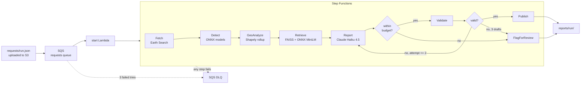

# AWS deployment (Phase 6): the pipeline as a serverless workflow

Uploading one small JSON file (an AOI and two date windows) to the bucket runs the whole
pipeline on AWS and writes the three validated reports back to the bucket. Nothing runs, and
almost nothing is billed, while no request is being processed.

Terraform in `infra/` with a Makefile, the same pattern as LexIntake. AWS profile `sky`,
region **us-east-2 only** (Terraform refuses any other region).



## What runs where

| piece | AWS service | notes |
|---|---|---|
| bucket | S3 (private) | `requests/ models/ index/ osm/ layers/ reports/`. Public access blocked, ACLs off, HTTPS only, encrypted. `layers/` expires after 30 days. |
| trigger | S3 event -> SQS -> `start` Lambda | the file name (`requests/<run_id>.json`) becomes the execution name, so one file starts one run |
| workflow | Step Functions (Standard) | `infra/statemachine/pipeline.asl.json.tftpl`. Retries AWS hiccups; the Report <-> Validate loop runs at most 2 retries |
| steps | 7 Lambdas, one container image (ECR, arm64) | each runs one function of `src/impactlens/aws/handlers.py`. At most 3,008 MB memory each (account limit, see below) |
| failures | SQS dead-letter queue | gets the run id and error of any failed run, and requests the starter could not start |
| Anthropic key | SSM Parameter Store, SecureString | set by you (`make set-key`); Terraform only creates a placeholder and ignores its value, so the key is never in code or state |

### The Lambda image has no PyTorch

PyTorch is about 700 MB and only needed for training. The image (about 1.5 GB unpacked) holds:

- **onnxruntime** for the two trained models (the same `.onnx` files as locally).
- **An ONNX export of all-MiniLM-L6-v2** for retrieval, run with the `tokenizers` library
  (`impactlens export-embedder`). Its vectors match sentence-transformers (cosine 1.0000).
  FAISS returns the same SOP excerpts for all six queries.
- **faiss-cpu**, **rasterio**, **Shapely**, **pystac-client** and the **anthropic** SDK.

The base is the AWS Lambda **Python 3.12** image, not 3.11. The 3.11 Lambda image runs on
Amazon Linux 2 (glibc 2.26), which is too old for current numpy and onnxruntime wheels. The
code is the same; the local environment stays on 3.11. The rasterio wheel also needs `expat`,
which the Dockerfile installs.

### The rollup runs without PostGIS

Running a database just for one rollup per request would cost money while idle. So the
spatial SQL (`geo/sql/rollup.sql`) is reimplemented in Shapely (`geo/rollup_shapely.py`).
Shapely uses GEOS, the same geometry engine as PostGIS. Both backends produce the same small
tables. One shared function (`geo/summary.py`) turns those tables into summary.json, so the
two backends cannot drift apart in how numbers are added up or rounded.

| check | result |
|---|---|
| refactored PostGIS run vs the saved summary.json | identical |
| Shapely vs PostGIS on Valencia | identical except 3 town "vegetated area" values, off by 0.1-0.2 ha (simplified town outlines rasterised), and the arbitrary hotspot id labels |
| speed | Shapely 11 s, PostGIS 55 s |
| full run inside the Lambda image (new fetch, ONNX on Linux arm64, Overpass) | same scenes, same summary as the local run |

`tests/test_geo.py` runs every synthetic rollup case through both backends;
`tests/test_aws.py::test_shapely_rollup_matches_postgis_on_valencia` checks the real data.

### OSM is fetched once per AOI

GeoAnalyze names each AOI by a hash of its bounds and keeps Overpass's three answers (land use,
coastline, municipalities) under `osm/` in the bucket. The next request for the same AOI
reads them from S3: GeoAnalyze took 87 s the first time and 12 s the second, with no Overpass
call.

### Local and cloud share the agent logic

LangGraph orchestrates the agents locally, and Step Functions does it on AWS. Both call the
same functions in `agents/steps.py` (retrieve, write reports, check reports, save the run).
The retry loop, the validator and the cost cap are therefore identical. On AWS each step is a
new process, so the Report Lambda reads the run's spend so far back from
`reports/<run_id>/work/tokens.jsonl`, and the **$0.10 cap holds per run**, not per Lambda.

### Account limit: 3,008 MB per Lambda

This account allows at most 3,008 MB of memory per function. The first deploy failed
because Detect asked for 6,144 MB. Memory is now set per function in
`var.lambda_memory_mb` (`infra/variables.tf`). Its validation rejects any value above
3,008 MB at `terraform plan`, before anything is created. Detect and GeoAnalyze use the
maximum, which gives about 1.7 vCPU. Detect's 900 s timeout leaves plenty of room: it took
12 s in the image on the laptop.

## Request format

```json
{
  "aoi": { "type": "Polygon", "coordinates": [[[-0.457, 39.273], "..."]] },
  "before": "2024-10-01/2024-10-28",
  "after": "2024-10-30/2024-11-12",
  "max_cloud": 20,
  "event": { "name": "DANA (cut-off low) floods, Valencia province, Spain", "event_date": "2024-10-29" }
}
```

- `aoi` may be a Feature, a FeatureCollection or a geometry, in lon/lat. It may be at most
  2,500 km2, which bounds Lambda time and Overpass load.
- `max_cloud` and `event` are optional.
- `scripts/make_request.py` writes the Valencia one.

## Before deploying (on the laptop)

```bash
uv run impactlens export-embedder   # build/embedder/minilm.onnx + tokenizer.json
uv run impactlens sops              # data/processed/rag/sops.faiss + chunks.jsonl (if not there)
make local                          # whole AWS pipeline inside the Lambda image, no AWS, no API cost
```

`make local` runs the real state machine definition with a small interpreter
(`aws/local.py`). It uses a folder in place of the bucket and a fake LLM, so the reports are
flagged for review by design. What it runs for real: the Earth Search fetch, ONNX inference,
Overpass (cached after the first run), the Shapely rollup and ONNX retrieval. Inside the
container: Fetch 36 s, Detect 12 s, GeoAnalyze 87 s (12 s cached).

## Deploy (you run these; each Terraform apply asks you to type "yes")

```bash
aws login --profile sky
make deploy     # 1 ECR repo, 2 build + push image, 3 everything else, 4 upload models + index
make set-key    # Anthropic key -> SSM (hidden prompt)
make demo       # upload the Valencia request, wait, download reports to build/aws_reports/<run_id>/
make destroy    # remove everything (bucket contents and images included)
```

`make plan` shows what would change without creating anything.

## Cost

### Idle (nothing running): about $0.05-0.20 a month

| item | monthly |
|---|---|
| ECR image storage (about 0.5 GB compressed; the newest 3 images are kept) | $0.05-0.15 |
| S3: models 34 MB, embedder 90 MB, index, OSM cache, reports (rasters expire after 30 days) | under $0.01 |
| SQS long-polling by the starter's event source mapping (about 0.65 M requests a month) | $0 within the always-free 1 M requests, otherwise about $0.26 |
| Lambda, Step Functions, SSM standard parameter, aws/ssm KMS key, CloudWatch Logs (14 days) | $0 when idle |

There is no NAT gateway and no VPC, because the Lambdas use AWS's default internet access.
There is no database and no always-on compute.

### Per run: about $0.03-0.07

| item | per run |
|---|---|
| Lambda (arm64), about 500-800 GB-seconds, mostly Detect and GeoAnalyze | about $0.01 (free tier: 400,000 GB-s a month) |
| Step Functions, 15-20 state transitions | about $0.0005 |
| Claude Haiku 4.5: 3 reports with caching, plus any retries; hard cap $0.10 | $0.02-0.05 |

## Security

- **Bucket.** Private. Public access is blocked, ACLs are disabled, plain HTTP is denied and
  objects are encrypted at rest.
- **Lambda permissions.** One IAM role per Lambda. Each role may read and write only its own
  S3 prefixes. Only `report` may read the key parameter, and only `start` may start the
  workflow.
- **Anthropic key.** It lives only in SSM, as a SecureString. `make set-key` reads it at a
  hidden prompt. Terraform state holds only the placeholder `REPLACE_ME`.
- **Image.** It contains the package source and nothing else. `.dockerignore` is an
  allow-list, so `data/`, `build/`, `.env` and the models never enter it. The models and the
  SOP index sit in the private bucket and are read at run time.

## Known limits

- The audience prompts name the Valencia stakeholders (for example l'Horta Sud
  municipalities). A request for another region runs, but the prompts would need a
  per-request audience list.
- Execution names must be unique, so uploading the same `requests/<run_id>.json` twice fails
  the second time. The failed start lands in the DLQ. Use a new file name for each run.
- The PostGIS schema stores geometry in EPSG:32630 (UTM 30N, right for Valencia). The Shapely
  backend works in the scene's own UTM zone, so it is the more general of the two.
