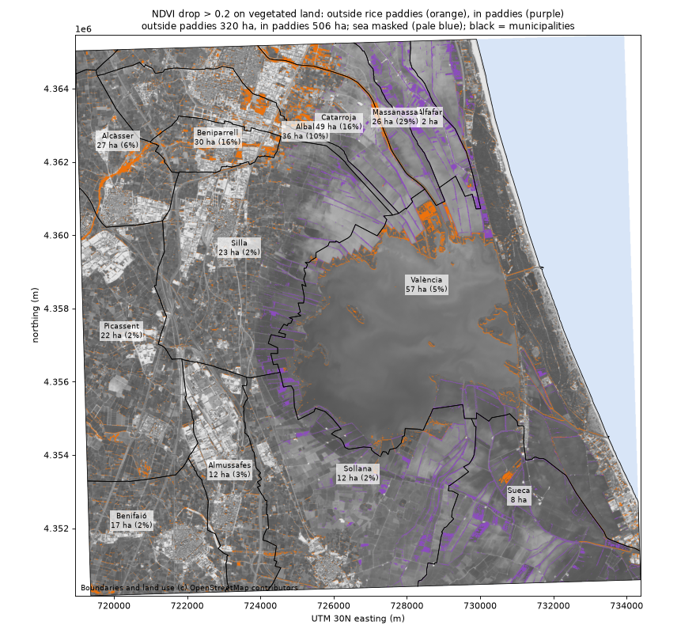
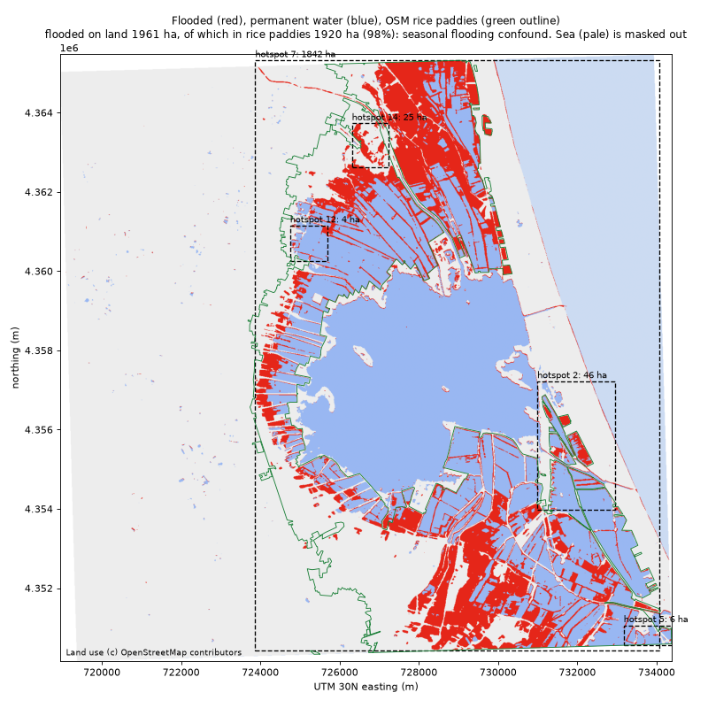

# Geo-AI (Phase 4): from pixels to hectares per plot

```bash
docker compose up -d                                   # local PostGIS (password in .env)
uv run impactlens infer --quicklook docs/images/valencia_quicklook.png
uv run impactlens rollup --map docs/images/valencia_rollup.png --ndvi-map docs/images/valencia_ndvi_drop.png
```

Outputs (gitignored, under `data/processed/valencia_albufera/`):
- `layers/*.tif`: one GeoTIFF per layer on the scene's 10 m UTM 30N grid: `water_before`,
  `water_after`, `flood_prob`, `flooded`, `permanent_water`, `change_prob`, `changed`,
  `ndvi_before`, `ndvi_after`, `ndvi_drop`, `ndvi_dropped`, `valid`; plus `infer_summary.json`.
- `geo/summary.json`: the numbers the report agents must stay consistent with (Phase 5).
- `geo/impact_plots.geojson` (OSM plots with hectares + severity) and `geo/hotspots.geojson`.

## How it works

1. **Sliding-window inference** (`geo/inference.py`): 256 px windows, 64 px overlap, Hann-window
   blending (no seams), through the exported ONNX models. Flood U-Net (6 bands) on each date;
   Siamese U-Net (4 bands) on the pair. Water threshold 0.45 = the value tuned on Sen1Floods11 val.
2. **Flooded = water after AND NOT water before.** The Albufera lake is water on both dates, so it
   is `permanent_water`, not flooded. Confidence = P(water after) x P(not water before).
3. **NDVI drop**: NDVI before - after > 0.2 where NDVI before > 0.3 (it was vegetated).
4. **Polygonize** (`geo/polygonize.py`): connected regions (8-neighbour), >= 4 px, with mean
   confidence. **OSM** via Overpass (`geo/osm.py`), cached in `data/raw/osm/`: land use,
   municipalities (admin_level 8) and the coastline. **Land mask**: the AOI is cut along the
   OSM `natural=coastline` ways (OSM draws them with land on the left); the sea side enters no
   total. Cross-check: 99.6% of that sea is MNDWI water on the before date.
5. **Spatial SQL** (`geo/sql/rollup.sql`, all in EPSG:32630 metres):
   - exclusive land cover per type (OSM polygons overlap; priority rice_paddy > water >
     residential > industrial > orchard > farmland > wetland > other; rest of the land =
     `unmapped`, mostly huerta fields OSM has not tagged; the sea is its own excluded class)
   - hectares per plot and per type for flooded / changed / NDVI drop
   - severity per plot = flooded fraction x mean confidence: high >= 0.30, medium >= 0.10, low > 0
   - hotspots: `ST_ClusterDBSCAN` (eps 100 m, minpoints 3) over flooded polygons on land
   - per municipality and class: hectares of each impact kind (`town_cover`, `town_impact`)
6. **Impacts split three ways** in `summary.json` -> `impacts`: `standing_water`
   (paddy-confounded), `vegetation_loss_likely_mud` (NDVI drop outside paddies, with a per-town
   rate = drop / vegetated land outside paddies), `urban_change` (OSCD change on residential +
   industrial land only). Sea numbers live under `excluded`, never in a total.

## Valencia results (before 2024-10-26, after 2024-11-10)

AOI 22,327 ha: 16,747 ha land, 2,656 ha inland water (Albufera lake, canals), 2,923 ha sea.

| impact (on land) | hectares | what it means |
|---|---|---|
| Standing water (new water) | 1,961 | 98% of it (1,920 ha) is in rice paddies: confounded, see below |
| ...outside rice paddies | 41 | |
| Vegetation loss / likely mud (NDVI drop outside paddies) | 320 | candidate damage footprint |
| NDVI drop inside paddies (not counted above) | 506 | harvest / paddy flooding, ambiguous |
| Change on urban land (OSCD model) | 60 | 44 ha industrial, 15 ha residential |
| *Excluded: sea "flooded"* | *655* | *model domain gap on the before date; never in a total* |

**Day 12 is too late for water.** The DANA hit on Oct 29. By Nov 10 the standing water in the
towns west of the lake had drained and left mud, so a water detector correctly finds almost
nothing there (41 ha outside paddies). The remaining new water is in the paddies.

**The damage shows up as vegetation loss on the Barranco del Poyo towns.** NDVI drop as a share
of each town's vegetated land outside the paddies (towns with >= 50 ha vegetated):

| town | vegetated ha (outside paddies) | NDVI drop ha | rate |
|---|---|---|---|
| Massanassa | 87 | 26 | **29%** |
| Beniparrell | 188 | 30 | **16%** |
| Catarroja | 313 | 49 | **16%** |
| Albal | 344 | 36 | **10%** |
| Alcàsser | 490 | 27 | 5.5% |
| València (southern part) | 1,241 | 57 | 4.6% |
| Almussafes | 395 | 12 | 3.0% |
| Silla | 934 | 23 | 2.5% |
| Benifaió | 675 | 17 | 2.5% |
| Sollana | 528 | 12 | 2.2% |
| Picassent | 1,177 | 22 | 1.9% |

The four towns on the Poyo's path to the lake lose vegetation at 10-29%. Similar huerta towns to
the south and west sit at 2-3%, five to ten times lower. On the map the orange is concentrated in
the north of the AOI and in strips running toward the lake. This is consistent with mud
deposits and flattened vegetation, but NDVI alone can't prove it: harvest, ploughing and pruning
also drop NDVI, and mud on streets and roofs is invisible here because that ground was not
vegetated before. Most of the drop (211 of 320 ha) is on land OSM has no land-use tag for, so
the per-class split is weaker than the per-town one.



**The AOI misses the worst-hit towns.** The AOI's north edge is 39.407 N. Only Albal and the
southern part of Catarroja's centre are inside. Paiporta (39.428 N), Picanya (39.435), Massanassa
(39.411), Alfafar (39.420), Benetússer (39.423) and Sedaví (39.425) are all north of it; their
municipal land inside the AOI is mostly paddy and lake shore. They lie north, not west: the west
edge (-0.457) already covers them in longitude. Extending the north edge to about 39.44 N
(+3.7 km) would bring all of them in.

**Known confound: rice paddies.** Albufera paddies are flooded on purpose in late autumn and
winter. 41.0% of paddy area was already water on Oct 26 (three days BEFORE the Oct 29 DANA) and
69.9% on Nov 10. The DANA floodwater also drained into the Albufera through l'Horta Sud, so the
extra paddy water can be either cause, and two optical dates cannot tell them apart. That is why
the paddies are a flagged confound rather than counted as damage or as farming.
The paddies are reported separately (`rice_paddies` in the summary, `seasonal_flooding_flag` per
plot), never dropped. The OSCD change model also fires on the paddies (1,892 ha of its change), as
expected for a model trained on urban change: flooding a field is a big visual change.

**Sanity check (model vs water indices on Valencia, IoU of the water masks):**

| date | NDWI > 0 | MNDWI > 0 | MNDWI > 0.15 |
|---|---|---|---|
| before | 0.78 | 0.84 | 0.85 |
| after | 0.90 | 0.95 | 0.95 |

Agreement is high, so the L1C-train / L2A-inference gap does not break the model overall. It does
show up in one place: part of the **open sea on Oct 26** gets P(water) ~0.37 from the model while
MNDWI there is 0.74 (clearly water). That sea strip then looks "flooded" on Nov 10 (655 ha).
The OSM coastline mask puts it in the `sea` class, so it enters no total and no hotspot; it is
kept under `excluded` in the summary as a diagnostic.



Land use (c) OpenStreetMap contributors (ODbL). Imagery: Copernicus Sentinel-2 via Earth Search.
