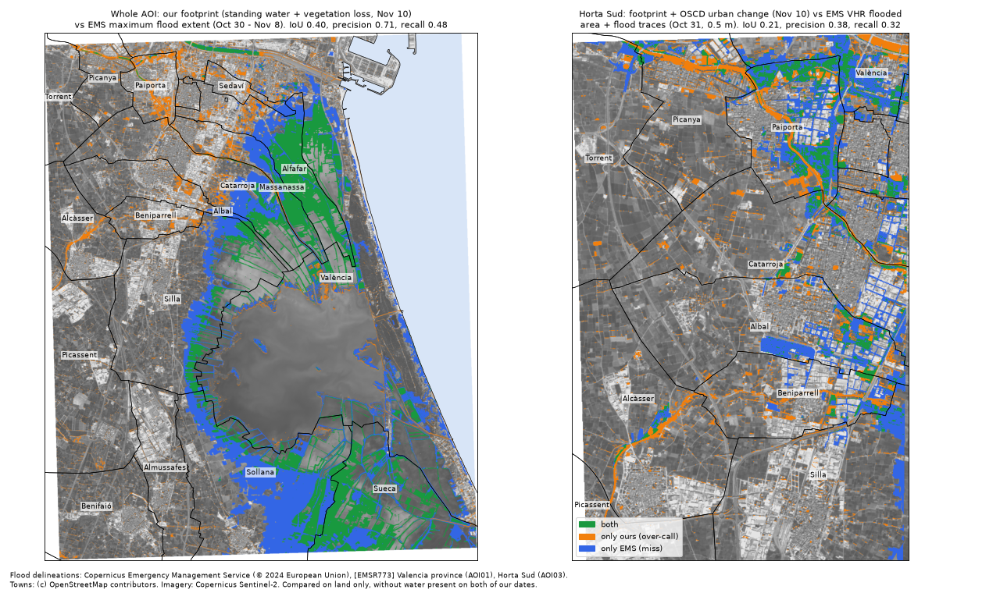

# External validation: ImpactLens vs Copernicus EMS EMSR773

How well does our Valencia footprint match the official flood maps? Copernicus Emergency
Management Service (EMS) Rapid Mapping was activated for the DANA floods as **EMSR773**. Its
analysts drew flood polygons from satellite images taken between Oct 30 and Nov 8, 2024. Our
after scene is **Sentinel-2, Nov 10**. We compare the two pixel by pixel on our 10 m grid.

```bash
# the EMS files (about 140 MB of zips, gitignored), then the comparison (about 10 s)
mkdir -p data/raw/emsr773 && cd data/raw/emsr773
for p in AOI01/DEL_PRODUCT/EMSR773_AOI01_DEL_PRODUCT_v1 AOI01/DEL_MONIT01/EMSR773_AOI01_DEL_MONIT01_v1 \
         AOI01/DEL_MONIT02/EMSR773_AOI01_DEL_MONIT02_v1 AOI01/DEL_MONIT03/EMSR773_AOI01_DEL_MONIT03_v1 \
         AOI01/DEL_MONIT04/EMSR773_AOI01_DEL_MONIT04_v1 AOI03/DEL_PRODUCT/EMSR773_AOI03_DEL_PRODUCT_v1; do
  curl -sfLO "https://rapidmapping.emergency.copernicus.eu/backend/EMSR773/$p.zip"; done
for z in *.zip; do unzip -oq "$z" '*.json' '*_source_v1.xml'; done; cd -
uv run impactlens validate-ems --map docs/images/valencia_emsr773.png
```

Code: `src/impactlens/geo/validation.py`, tests in `tests/test_validation.py`. Full numbers:
`data/processed/valencia_albufera/validation/emsr773.json`.

## Headline

| question | answer |
|---|---|
| Does our town ranking match where EMS mapped flooding and mud? | **Yes.** Across 12 Horta Sud towns, our NDVI-drop rate vs the share of each town EMS mapped as flooded or flood-traced at 0.5 m: **Spearman 0.85**. Paiporta is first on both (our 41.6%, EMS 42.8% of its land). |
| Does our footprint land where EMS saw the flood? | **Mostly.** 71% of our footprint is inside the EMS maximum flood extent (precision 0.71), against 25% of the land on average: **2.8x better than chance**. IoU 0.40. |
| Do we find all of the flood? | **No.** We find 48% of the EMS maximum extent overall, and much less in town streets. Recall in Horta Sud is 0.32 even with the urban change layer. |
| Is our water layer right on the day? | **Consistent with draining.** Our Nov 10 standing water covers 26% of the Oct 31 EMS flood, then 65%, 48%, 86% and **89% of the Nov 8 EMS flood** (2 days before ours). |

## The reference products

All from Copernicus Emergency Management Service (© 2024 European Union), [EMSR773] Flood in
Valencia Region, Spain. Delineation (DEL) products, vector data, `observedEventA` layer
(notations "Flooded area" and "Flood trace") and `maximumFloodExtentA`.

| product | EMS image(s) | date | days before our Nov 10 scene | covers our AOI |
|---|---|---|---|---|
| AOI01 Valencia province, DEL | Sentinel-2, Landsat-8, Sentinel-1 | Oct 30-31 | 10-11 | 100% |
| AOI01 monitoring 1 | ICEYE (radar) | Nov 3 | 7 | 100% |
| AOI01 monitoring 2 | Sentinel-2 | Nov 5 | 5 | 100% |
| AOI01 monitoring 3 | Sentinel-1 (radar) | Nov 6 | 4 | 100% |
| AOI01 monitoring 4 (+ maximum flood extent, the union of all dates) | COSMO-SkyMed (radar) | Nov 8 | 2 | 100% |
| AOI03 Horta Sud, DEL | GeoEye-1 / WorldView-2, 0.5 m | Oct 31 | 10 | 19% (Paiporta, Catarroja, Albal, Picanya, Beniparrell, Silla...) |

**License.** EMS gives free access to its On-Demand Mapping data for reproduction,
distribution, adaptation and combination with other data, on condition that recipients are told
the source ([terms](https://mapping.emergency.copernicus.eu/terms-and-conditions/)). The citation
format follows the [EMS citation guidelines](https://mapping.emergency.copernicus.eu/about/citation-guidelines/).
The EMS files are not in this repo (`data/` is gitignored); only our derived numbers and map are.

## How the comparison works

- **Same grid.** EMS polygons (lon/lat) are burned onto our 10 m UTM grid (pixel centre inside).
- **Same domain.** Only pixels that both sides could have mapped count: land (OSM coastline)
  inside our AOI, inside the EMS area of interest and image footprint, valid in our scenes, and
  not water on both of our dates (the Albufera lake and canals are not a flood for either side).
  18,470 ha for AOI01, 5,160 ha for AOI03.
- **Our layers.** *Standing water* = water on Nov 10 that was not water on Oct 26. *Vegetation
  loss* = NDVI drop > 0.2 on land that was vegetated, outside rice paddies. *Footprint* = the
  two together. A variant adds OSCD change on residential and industrial land.
- **Metrics.** Precision = share of our pixels inside the EMS polygons (1 - over-call). Recall =
  share of EMS pixels we also flag (1 - miss). IoU = intersection / union. Lift = precision
  divided by the share of the domain EMS flags, so 1.0 means no better than a random pixel.

Standing water here is 2,224 ha, slightly more than the 2,104 ha in `summary.json`, because this
comparison masks land by pixel centre on the raster while the rollup clips polygons.

## 1. Standing water vs each EMS date (whole AOI)

| EMS date | EMS flooded ha | ours ha | IoU | precision | recall | lift |
|---|---|---|---|---|---|---|
| Oct 31 | 8,176 | 2,224 | 0.26 | 0.96 | 0.26 | 2.2 |
| Nov 3 | 3,050 | 2,224 | 0.61 | 0.89 | 0.65 | 5.4 |
| Nov 5 | 4,252 | 2,224 | 0.45 | 0.91 | 0.48 | 3.9 |
| Nov 6 | 1,869 | 2,224 | 0.65 | 0.72 | 0.86 | 7.1 |
| Nov 8 | 1,366 | 2,224 | 0.51 | 0.55 | 0.89 | 7.4 |

The flood shrank fast: EMS mapped 8,176 ha on Oct 31 and 1,366 ha on Nov 8. Our Nov 10 water
covers 89% of what was still flooded on Nov 8. The other way round, 45% of our water is outside
the Nov 8 polygons. Almost all of that is rice paddies, which farmers flood on purpose in late
autumn and EMS stopped counting as flood. Nov 5 does not fit the trend (more EMS flood than on
Nov 3) because a different sensor and analyst mapped it; both Sentinel-2 dates (Oct 31, Nov 5)
map more water than the radar dates.

**Outside the paddies, our water layer misses the flood.** EMS mapped 4,020 ha of non-paddy flood
on Oct 31; we flag 156 ha of non-paddy water on Nov 10 and overlap 74 ha of it (recall 1.8%). By
Nov 10 that water had drained. This is the date gap, not a model error: on Nov 6-8 the overlap is
44-52% of the little non-paddy water EMS still saw.

## 2. Our footprint vs the EMS maximum flood extent (whole AOI)

EMS maximum flood extent = every pixel flooded on any EMS date up to Nov 8 (4,630 ha in the
domain; 3,960 ha of it in rice paddies, 670 ha outside).

| our layer | where | ours ha | both ha | IoU | precision | recall | lift |
|---|---|---|---|---|---|---|---|
| footprint | all land | 3,098 | 2,210 | **0.40** | **0.71** | **0.48** | **2.8** |
| standing water | all land | 2,224 | 2,131 | 0.45 | 0.96 | 0.46 | 3.8 |
| standing water | inside paddies | 2,068 | 2,068 | 0.52 | 1.00 | 0.52 | 1.1 |
| footprint | outside paddies | 1,030 | 142 | 0.09 | 0.14 | 0.21 | 2.9 |
| vegetation loss | outside paddies | 968 | 119 | 0.08 | 0.12 | 0.18 | 2.6 |
| footprint + urban change | outside paddies | 1,212 | 144 | 0.08 | 0.12 | 0.21 | 2.5 |

- **Inside the paddies** everything we call water was inside the EMS extent (precision 1.00), but
  the lift is only 1.1 because EMS mapped most paddies as flooded at some point. The paddies say
  little about skill either way, which is why our reports flag them as a confound.
- **Outside the paddies**, our footprint is 2.9 times more likely than a random land pixel to be
  in the EMS extent. But 86% of it is outside: the AOI01 maps (radar and Sentinel-2, published
  at 1:244,000) mostly delineate open water in fields and miss mud in towns. They map only 1.3%
  of Paiporta, where the Poyo overflowed. For the towns, the 0.5 m AOI03 map is the better
  reference.

## 3. Horta Sud: our footprint vs the EMS 0.5 m delineation (Oct 31)

EMS mapped 624 ha in this area, 593 ha of it as **flood traces** (mud and debris left behind),
which is what our vegetation-loss layer is meant to find.

| our layer | ours ha | both ha | IoU | precision | recall | lift |
|---|---|---|---|---|---|---|
| standing water | 21 | 0.6 | 0.00 | 0.03 | 0.00 | 0.2 |
| vegetation loss | 417 | 148 | 0.17 | 0.35 | 0.24 | 2.9 |
| footprint + urban change | 523 | 196 | **0.21** | **0.38** | **0.32** | **3.1** |

No standing water was left in these towns by Nov 10, as expected. Vegetation loss finds a quarter
of the EMS traces at 2.9x chance; adding OSCD change on urban land lifts recall to 32%.

**Where we miss:** the blue on the right of the map is streets and building blocks in Paiporta,
Massanassa, Alfafar and Albal. EMS saw mud there at 0.5 m; NDVI cannot, because that ground was
never vegetated, and 10 m pixels mix streets with roofs.

**Where we over-call:** the orange follows the Barranco del Poyo channel itself and fields west
of the towns (Picanya, Alcàsser, Torrent). From these two sources we cannot tell how much of it
is flood damage EMS did not draw as a trace (for example scour along the channel) and how much
is harvest or ploughing, which also drops NDVI. Both are counted as over-calls here.

## 4. Per town

Outside rice paddies. *Our rate* = NDVI drop / vegetated land (the published number from
`summary.json` and docs/GEO.md). *EMS share* = % of the town's non-paddy land inside the EMS
polygons. P / R = precision / recall of our footprint (+ urban change for the 0.5 m map).

| town | our rate | EMS 0.5 m share | P | R | EMS max-extent share |
|---|---|---|---|---|---|
| Paiporta | **41.6%** | **42.8%** | 0.62 | 0.43 | 1.3% |
| Sedaví | 40.5% | (outside AOI03) | | | 3.7% |
| Alfafar | 36.8% | 22.5% (91 ha in AOI03) | 0.51 | 0.37 | 8.3% |
| Massanassa | 30.6% | 21.4% (124 ha in AOI03) | 0.37 | 0.26 | 2.4% |
| Beniparrell | 16.0% | 10.4% | 0.23 | 0.27 | 0.0% |
| Catarroja | 13.2% | 9.4% | 0.37 | 0.36 | 2.9% |
| Albal | 10.4% | 14.2% | 0.42 | 0.24 | 0.0% |
| València (south) | 9.5% | 41.5% (239 ha in AOI03) | 0.50 | 0.30 | 15.8% |
| Picanya | 9.3% | 5.5% | 0.16 | 0.40 | 0.8% |
| Alcàsser | 5.5% | 1.8% | 0.12 | 0.40 | 0.0% |
| Silla | 2.5% | 4.3% | 0.15 | 0.11 | 1.0% |
| Torrent | 2.0% | 3.0% | 0.17 | 0.16 | 0.0% |
| Picassent | 1.9% | 0.0% | 0.00 | | 0.0% |

**Rank agreement (Spearman) of our rate with the EMS share:** 0.85 for the 0.5 m map (12 towns);
0.44 for the AOI01 maximum extent (16 towns), which barely maps the towns at all. The one large
disagreement is València: EMS mapped 41.5% of the 239 ha of the city's land inside AOI03, but our
rate is computed over all 1,722 ha of vegetated València land in our AOI, most of it far from
the flood, so it comes out at 9.5%. The two numbers measure different areas.



## Honest summary

- **What holds up:** the ranking. Without any location hints, our vegetation-loss rate puts
  Paiporta first and the towns downstream of the Poyo next, and the official 0.5 m delineation
  ranks them the same way (Spearman 0.85). Our water layer tracks the shrinking flood: it
  covers 89% of the EMS flood two days before our image.
- **What does not:** pixel-level agreement in the towns is modest (IoU 0.21, recall 0.32), and
  most of the urban mud is invisible to a 10 m vegetation index. Outside the paddies, most of our
  footprint is not in the AOI01 extent.
- **Why:** (1) the date gap: EMS mapped the peak (Oct 30-31) and we see day 12, after the water
  drained; (2) NDVI is a proxy for mud on vegetated land only; (3) the rice paddies are flooded
  on purpose and dominate any water comparison; (4) the products differ in resolution (0.5 m
  analyst delineation vs 10 m automatic layers) and in what they map (water and traces vs NDVI
  drop and change).
- **What would close the gap:** an after image closer to the peak (for example Sentinel-1 radar,
  which clouds do not block), a mud / bare-soil index instead of NDVI drop, and a model trained
  on flood traces rather than on OSCD's urban change.
